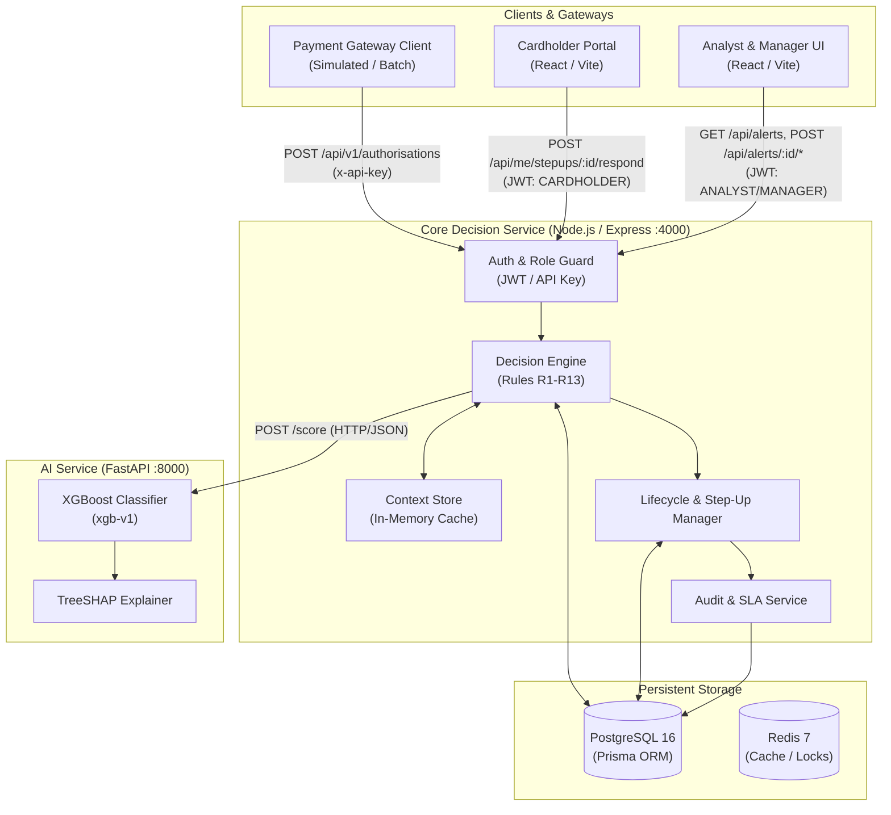
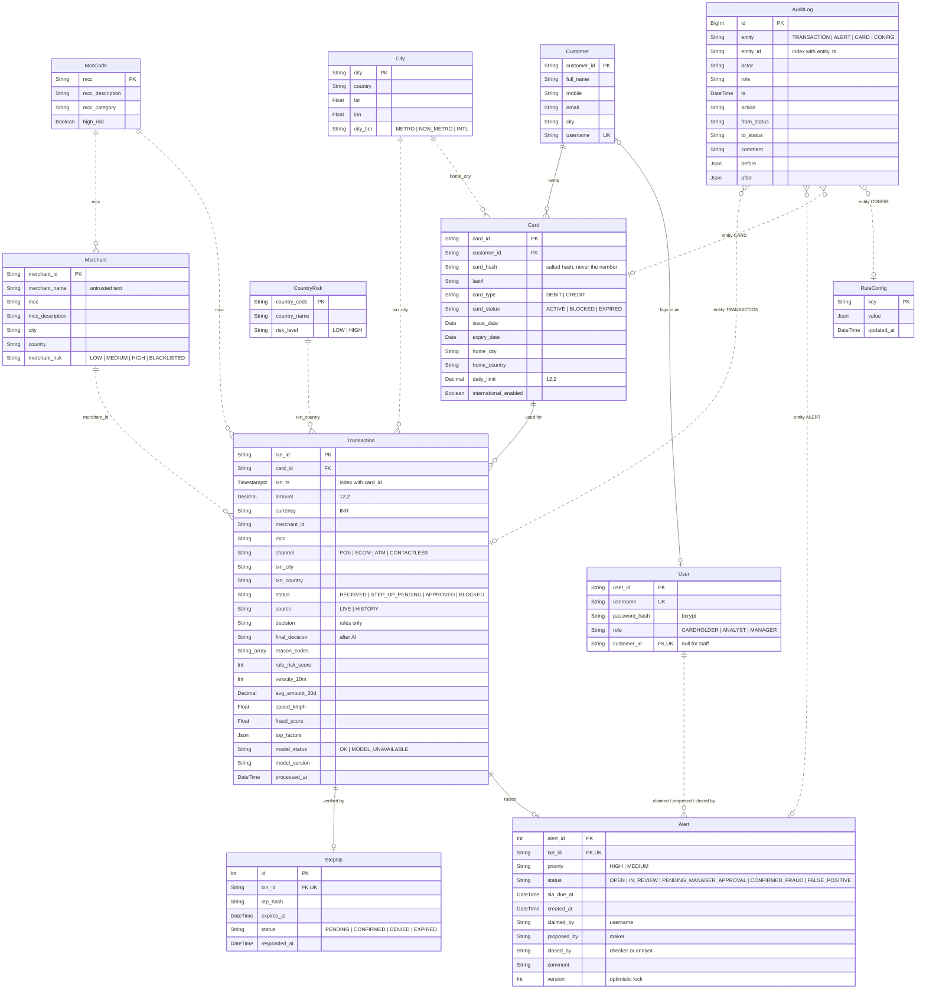
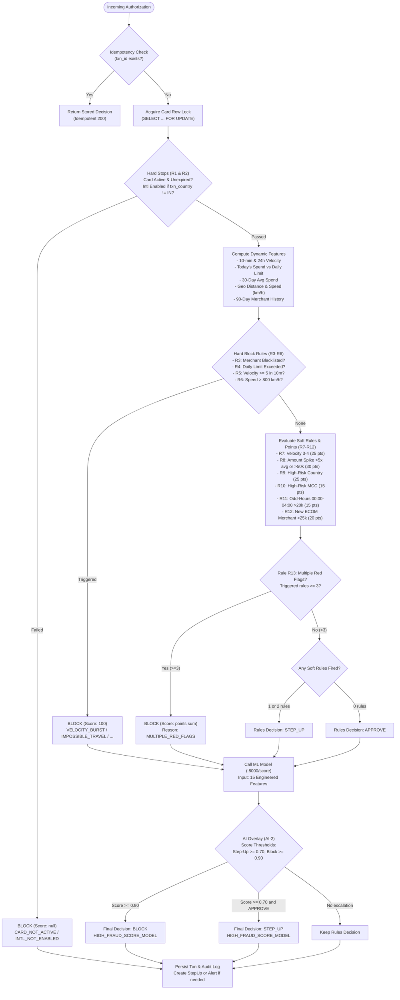
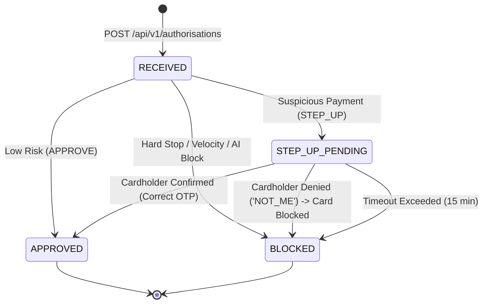
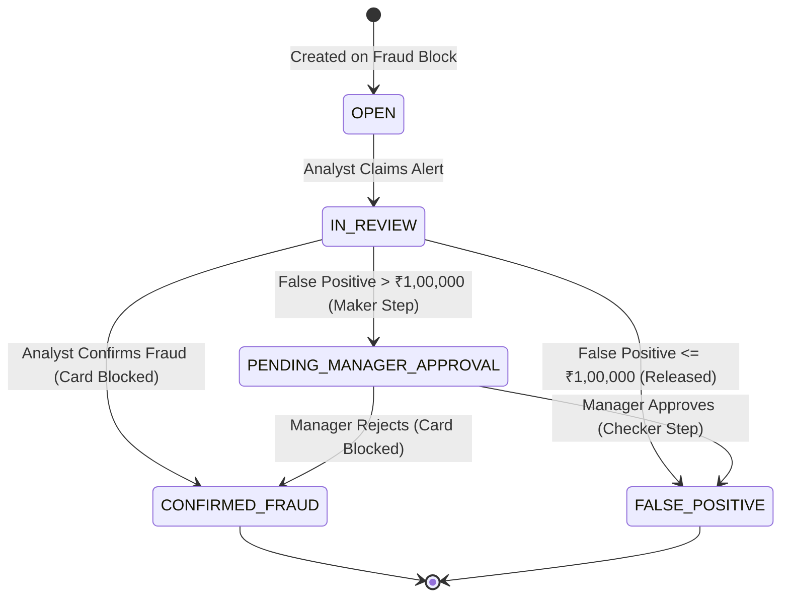

# FraudShield – System Design Document

**HCL BFSI Hackathon – Use Case 01: Retail Banking: Cards & Payments**  
*Real-Time Card Transaction Fraud Detection, Step-Up Verification, and Alert Management*

---

## 1. Executive Summary & Architecture Overview

FraudShield is an enterprise-grade real-time fraud mitigation and risk management system built for high-throughput retail payment processing. It couples a sub-50ms deterministic business rules engine with an AI overlay (XGBoost + SHAP explainer), a cardholder two-factor step-up authentication mechanism, an analyst alert investigation queue with strict SLAs, maker-checker governance on high-value releases, and an append-only audit trail.

### High-Level Architecture



---

## 2. Technology Decisions & Rationale

| Layer / Component | Technology Selected | Rationale & Justification |
|---|---|---|
| **Backend Core** | Node.js (v20+) & Express 5 | High asynchronous I/O efficiency for concurrent transaction processing; predictable event-loop latency. |
| **Database & ORM** | PostgreSQL 16 & Prisma 6 | ACID transactional integrity; exact `Decimal(12,2)` precision for financial amounts; conditional updates and row-level locking (`FOR UPDATE`). |
| **ML Inference Service** | Python 3.12 & FastAPI + Uvicorn | Ultra-low latency ASGI interface; native C++ bindings for XGBoost 3.4.1 and fast vectorized TreeSHAP calculations. |
| **Frontend Application** | React 18, Vite 6, TailwindCSS 4 | Instant sub-second hot reload; modern responsive component library; TanStack Query for 5s automatic polling of queues and SLA timers. |
| **Containerization** | Docker & Docker Compose | Single-command deployment reproducible across environments; isolated networking and healthchecks. |

---

## 3. Assumptions & Compliance Standards

1. **PCI-DSS Compliance (Masked Card Data):**
   - Full 16-digit Primary Account Numbers (PAN) are **never** stored, logged, transmitted, or displayed.
   - The database stores a salted SHA-256 hash (`card_hash`) and the unmasked `last4` digits.
   - All customer-facing and analyst-facing UIs display card numbers masked as `•••• 1234` or `XXXXXXXXXXXX1234`.
2. **Currency:**
   - Single-currency INR (`INR`) processing. Money is tracked using `Decimal(12,2)` to eliminate floating-point rounding errors.
3. **Authentication & Authorization:**
   - **System Integration:** The card authorization gateway uses a 24-byte random `GATEWAY_API_KEY` passed in the `x-api-key` header.
   - **Human Users:** Role-Based Access Control (RBAC) enforced via signed JSON Web Tokens (`JWT`) with roles `CARDHOLDER`, `ANALYST`, and `MANAGER`.
4. **Time & Locality:**
   - All timestamps are ISO-8601 with Indian Standard Time (+05:30) offset.
   - Odd-hour risk checks apply between 00:00 and 04:00 IST.

---

## 4. Database Schema & Entity-Relationship Diagram (ERD)

The data model is implemented in PostgreSQL via Prisma (`code/backend/prisma/schema.prisma`). Real database foreign keys enforce integrity, while reference dimensions (merchants, cities, MCCs) are validated in application logic.



---

## 5. Rules Evaluation & Decision Flowchart (R1–R13)

The decision engine evaluates incoming payment authorizations in a strict deterministic order. Hard-stop checks take precedence; if none fail, derived features are computed and soft risk points are aggregated, followed by the Machine Learning overlay.



---

## 6. State Lifecycle Diagrams

### 6.1 Transaction State Lifecycle



### 6.2 Alert State Lifecycle & Maker-Checker Dual Control



---

## 7. Concurrency & Idempotency Controls

1. **Card Concurrency Locking:**
   - To prevent race conditions during high-frequency velocity bursts, `decide.js` executes:
     ```sql
     SELECT card_id FROM "Card" WHERE card_id = $1 FOR UPDATE;
     ```
   - All transactions for a given card are serialized, ensuring velocity counters and daily limits are strictly accurate.
2. **Idempotency Guarantee:**
   - Resending a request with an existing `txn_id` returns the previously computed authorization decision without creating duplicate transactions, step-ups, alerts, or audit records.
3. **Optimistic Locking for Alerts:**
   - Every `Alert` row includes a `version` counter and updates require matching status:
     ```sql
     UPDATE "Alert" SET status = 'IN_REVIEW', claimed_by = $1, version = version + 1
     WHERE alert_id = $2 AND status = 'OPEN';
     ```
   - If two analysts simultaneously claim or act on the same alert, the second request fails with `HTTP 409 Conflict`.

---

## 8. API Specification Reference

Complete interactive OpenAPI documentation is served at runtime and persisted for offline evaluation:
* **Interactive Swagger UI:** `http://localhost:4000/api/docs`
* **OpenAPI 3.0 Export:** `output/design/openapi.json` (20 documented paths covering Auth, Authorisations, Cardholder self-service, Analyst Alerts, Manager Dashboard, Audit, and Config APIs).
