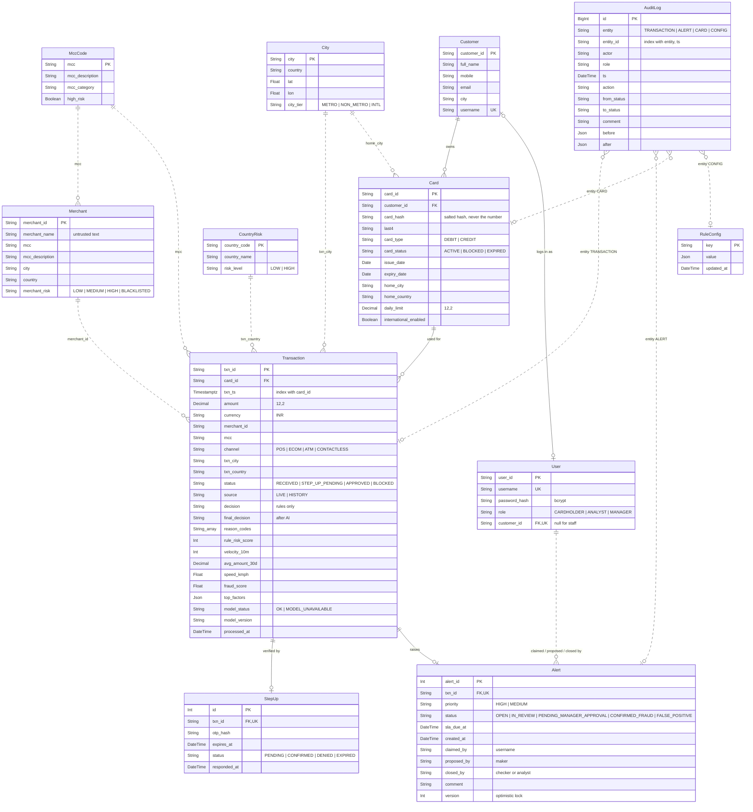

# FraudShield – ER diagram

Source: `code/backend/prisma/schema.prisma` (PostgreSQL). GitHub renders the diagram below.

- **Solid line**: real foreign key, enforced by the database.
- **Dotted line**: reference by ID or code, checked by the application (no FK constraint).

## Relationships

| From | To | Cardinality | Enforced by | Notes |
|---|---|---|---|---|
| Customer | Card | 1 to many | FK `Card.customer_id` | A customer can have several cards |
| Customer | User | 0..1 to 0..1 | FK `User.customer_id` (unique) | Cardholder logins only; staff users have no customer |
| Card | Transaction | 1 to many | FK `Transaction.card_id` | Indexed on `(card_id, txn_ts)` for velocity and history lookups |
| Transaction | StepUp | 1 to 0..1 | FK `StepUp.txn_id` (unique) | Only STEP_UP decisions create one; OTP stored as a hash |
| Transaction | Alert | 1 to 0..1 | FK `Alert.txn_id` (unique) | At most one alert per transaction |
| Merchant, MccCode, City, CountryRisk | Transaction / Card / Merchant | 1 to many | Application | Reference data loaded from the CSVs; looked up by code |
| User | Alert | 1 to many | Application | `claimed_by`, `proposed_by`, `closed_by` store usernames; maker and checker must differ |
| AuditLog | Transaction, Alert, Card, RuleConfig | many to 0..1 | Application | Polymorphic (`entity` + `entity_id`); append-only, no update or delete |

## Design notes

- **No full card numbers**: `Card` keeps only `card_hash` and `last4`.
- **Money** is `Decimal(12,2)`, never float.
- **Concurrency**: status changes are conditional updates; `Alert.version` increments on every change, so a second claim or decision gets HTTP 409.
- **Configuration**: every threshold lives in `RuleConfig` (loaded from `case_01_rules_config_V1.0.json`); changes write an `AuditLog` row with before and after values.
